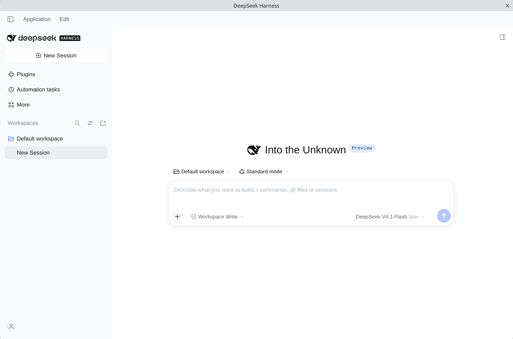
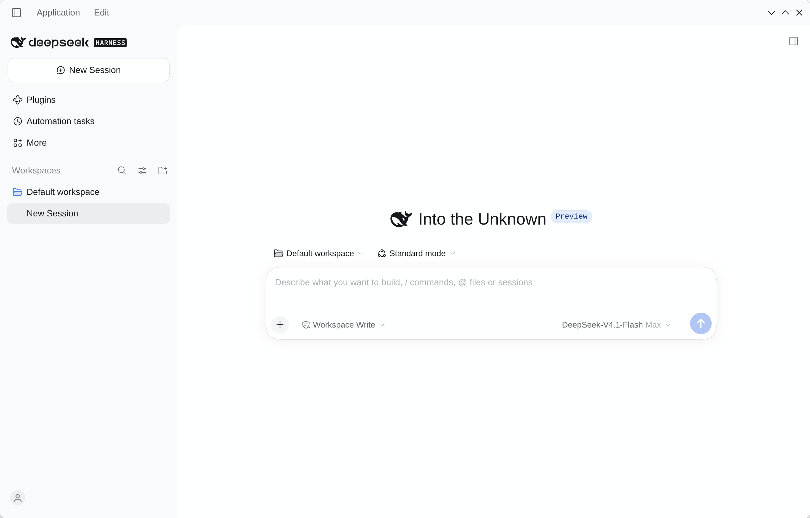
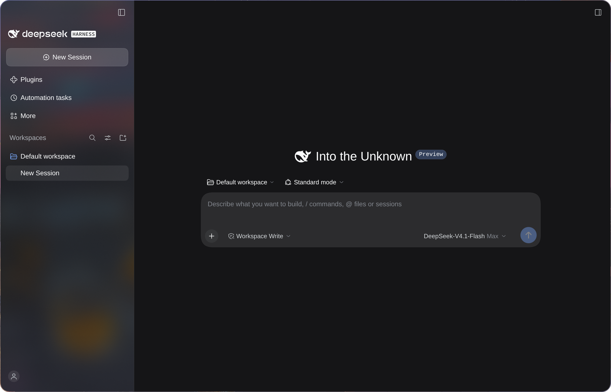

# dsh-desktop-linux

[中文](README.md) | **English**

Ports the **packaging pipeline** of the official
[DeepSeek Harness](https://github.com/deepseek-ai/deepseek-harness) desktop app
(the Electron application in `apps/desktop`) to Linux, producing
AppImage / deb / rpm / Arch packages.

Upstream does not support Linux today; this project fills that gap: it teaches
the official packaging pipeline about `linux-x64` and `linux-arm64` and emits
installable artifacts.

<p align="center">
  <br>
  <sub><em>Normal mode (KDE Plasma)</em></sub>
</p>

<p align="center">
  <br>
  <sub><em>Frameless mode (KDE Plasma, <code>DSH_DESKTOP_FRAMELESS=1</code>)</em></sub>
</p>

<p align="center">
  <br>
  <sub><em>Glass mode (Hyprland, <code>DSH_DESKTOP_GLASS=1 DSH_DESKTOP_GLASS_TINT=75</code>)</em></sub>
</p>

## What this project produces

What this project ships is **the official Electron application itself**:

- the renderer loads over its own `dsh-app://` protocol rather than connecting to a local web server;
- it carries its own Node / pnpm / Python runtime and does not use the system Node;
- it owns `$DSH_HOME/profiles/desktop` exclusively and does not touch the `web` profile.

## Install

Download the AppImage, deb, rpm and Arch packages from [Releases](https://github.com/ffyfox/dsh-desktop-linux/releases).

| Distribution | Format | How |
|---|---|---|
| Any | AppImage | `chmod +x`, run it |
| Debian / Ubuntu | deb | `sudo apt install ./deepseek-harness-*.deb` |
| Fedora / RHEL | rpm | `sudo dnf install ./deepseek-harness-*.rpm` |
| Arch Linux | `.pkg.tar.zst` | `sudo pacman -U ./dsh-desktop-linux-*.pkg.tar.zst` (not published to the AUR since AUR account registration is currently paused) |

## Usage

### Closing, the tray, and quitting

Closing the main window **hides it to the background** by default (the Host and running tasks keep going) instead of quitting:

- **Restore the window**: "Open" in the tray menu, or launch the application again (a second launch only focuses the running instance).
- **Quit completely**: "Quit" in the tray menu, `Application` → `Exit` in the menu bar, or `Ctrl+Q`.

### Frameless mode

Start the application with this variable to drop window-manager decorations and keep only the window control buttons:

```bash
DSH_DESKTOP_FRAMELESS=1 deepseek-harness
```

The window then resembles the official Windows desktop app:

- The system title bar is removed, and the top in-page strip handles dragging and double-click maximize / restore; the style, count, and placement of the window control buttons follow the system GTK theme and decoration layout.
- **Exclusive with glass mode**: when both variables are `1`, frameless wins and glass mode turns itself off.
- **Left-side button limitation**: when the system places window buttons on the left, the in-page menus shift right to clear them, but the sidebar toggle at the top is not fully adapted yet.

### Glass mode

To get a frosted-glass sidebar (or unblurred translucency), start the application with an environment variable:

```bash
DSH_DESKTOP_GLASS=1 deepseek-harness
```

The window then resembles the official macOS desktop app:

- The native menu bar auto-hides and appears on `Alt`.
- Sidebar fill defaults to 40% in the light theme and 50% in the dark theme; override with `DSH_DESKTOP_GLASS_TINT=0..100` (raise it when background content makes text hard to read).
- **Actual appearance depends on the compositor**: Hyprland, niri, and similar compositors support background blur; KDE and GNOME still draw a system title bar and only render translucency without blur — this mode generally looks best under **titlebar-less** tiling window managers.

> [!TIP]
> To enable either mode by default when launching from a desktop icon or app launcher, write the variables to `~/.config/environment.d/dsh-desktop.conf` (takes effect after logging back in), or copy `/usr/share/applications/deepseek-harness.desktop` to `~/.local/share/applications/` and prepend `env VAR=1` before `Exec=`.

## Building from source

Requirements: Node 24.9+ (**not your distro's own Node** — see below), **pnpm 11**, and git.
Building the rpm additionally needs `rpmbuild` on the system.

```bash
git clone https://github.com/ffyfox/dsh-desktop-linux
cd dsh-desktop-linux

./scripts/fetch-upstream.sh                   # fetch upstream sources (defaults to the tag pinned in PKGBUILD)
./scripts/apply-patches.sh                    # apply patches and place assets
pnpm --dir upstream install --frozen-lockfile # install upstream workspace dependencies
./scripts/build.sh --all                      # AppImage + deb + rpm
./scripts/verify.sh --runtime                 # verification matrix
```

`build.sh` flags: `--dir` (unpacked directory only, fastest for debugging), `--appimage` (default), `--deb`, `--rpm`, `--all`. Most of the time goes into compiling and preparing the runtime, so use `--all` when you need multiple formats in one pass.

Artifacts land in `upstream/apps/desktop/.desktop-build/targets/linux-x64/unsigned-artifacts/` (on arm64: `targets/linux-arm64/…`; `build.sh` picks the target from `uname -m`, and cross-building is not supported).

The deb / rpm `Maintainer` and `Homepage` come from `upstream/apps/desktop/.env.linux` (generated automatically from `.env.linux.example` on the first `build.sh` run; only that file is read, and same-named environment variables are ignored).

### Hard requirements

- **Node 24.9+ (with TypeScript type stripping enabled)**: some distro Node packages strip this feature and fail on the very first build step; use an official build from nodejs.org.
- **pnpm 11 (installed via npm or corepack)**: upstream declares `packageManager: pnpm@11.28.5`, and build scripts invoke the `pnpm` entry directly under `node`. The official standalone installer, Homebrew, and some rolling-release system packages (such as Arch Linux's pnpm 12 after self-management switches to `@pnpm/exe`) provide a native binary entry and fail with `SyntaxError`; `build.sh` and `PKGBUILD` automatically fall back to an isolated copy at `~/.local/share/dsh-pnpm-11` when the system `pnpm` is unusable, which you can prepare in advance:

  ```bash
  npm i --prefix ~/.local/share/dsh-pnpm-11 pnpm@11.28.5
  ```

### Building the Arch package

The `PKGBUILD` builds directly from upstream's release tarball and does not need `./upstream` checked out:

```bash
./scripts/pkgbuild-dir.sh     # flatten patches and assets into ./pkgbuild
cd pkgbuild && makepkg -si
```

Supports `x86_64` and `aarch64` (must be built natively on the target architecture).

## Implementation

```
Official Electron shell (apps/desktop)
├── renderer ──── dsh-app:// protocol ──── application UI
└── Host process ─── real Node from primary-runtime ─── bundled dsh runtime
                          └── $DSH_HOME/profiles/desktop
```

Three design points:

- **The Host runs on a real Node, not Electron's node mode.** Under Electron's
  node mode `sharp` segfaults while decoding, so on Linux the Host uses the Node
  bundled in primary-runtime. Consequently **Linux artifacts do not put the dsh
  tree into an asar** (a real Node cannot read inside an archive), which is why
  the installed directory is large.
- **Exclusive profile.** The desktop app owns `$DSH_HOME/profiles/desktop` exclusively, while sessions, settings, and credentials still live at the root of `$DSH_HOME` shared with the CLI. To reuse your `web` configuration, quit the desktop app and copy or rename `$DSH_HOME/profiles/web` into place; sharing the directory via a symlink also works, but both sides will write to it and unknown issues may occur across larger version gaps.
- **Sandboxing.** Where the kernel supports unprivileged user namespaces, the renderer uses the namespace sandbox; otherwise it falls back to a setuid `chrome-sandbox`. The AppImage probes this at launch, and the deb / rpm / Arch packages check it in their install scripts.

For patch numbering, responsibilities, and low-level details, see [patches/README.md](patches/README.md).

## Validation status

The table below is updated with testing and feedback — if you run into an adaptation
problem, please open an [issue](https://github.com/ffyfox/dsh-desktop-linux/issues).

| Environment | Status |
|---|---|
| Arch Linux · KDE Plasma 6 · Wayland · x86_64 | **Tested**, works |
| Arch Linux · Hyprland 0.57 · Wayland · x86_64 | **Tested**, works |
| Arch Linux · niri 26.04 · Wayland · x86_64 | **Tested**, works |
| Ubuntu 26.04 LTS · GNOME 50 · Wayland · x86_64 | **Tested**, works |
| Debian 13 · GNOME 48 · Wayland · x86_64 | **Tested**, works (the tray needs an extension, see [Known limitations](#known-limitations)) |
| Fedora 44 Workstation · GNOME 50 · Wayland · x86_64 | **Tested**, works (the tray needs an extension, see [Known limitations](#known-limitations)) |
| Kylin (Phytium D2000 · aarch64 · deb) | **Tested**, works ([#11](https://github.com/ffyfox/dsh-desktop-linux/issues/11)) |
| aarch64 (AppImage / rpm / Arch package) | Built and launch smoke-tested in CI |
| Other distributions (Linux Mint / CachyOS, …) | Not tested |
| Other DEs / WMs (Xfce / Sway, …) | Not tested |
| X11 | Not tested |

## Known limitations

- **GNOME shows no tray by default — install and enable the extension.** Install `gnome-shell-extension-appindicator` (preinstalled on Ubuntu; install manually on Debian / Fedora), **log out and back in**, then enable `ubuntu-appindicators@ubuntu.com`. Without an active tray host, a hidden window can only be recovered by launching the application again.
- **The AppImage needs FUSE 2 (`libfuse.so.2`) on the system.** Mainstream distributions now install only FUSE 3 by default, so running the AppImage directly fails with `dlopen(): error loading libfuse.so.2`. Install the matching package — Fedora `sudo dnf install fuse-libs`, Debian 13 and Ubuntu 24.04+ `sudo apt install libfuse2t64` (`libfuse2` on Ubuntu 22.04) — or bypass it with `APPIMAGE_EXTRACT_AND_RUN=1 ./deepseek-harness-*.AppImage`.
- **No auto-update.** Upstream's update channels only target Windows and macOS; the Linux build embeds no update policy and does not auto-update.
- **No "install the command line tool" entry.** Upstream only implements the menu action that adds `dsh` to PATH on macOS and Windows; to use `dsh` in a terminal, install it yourself or invoke the bundled `resources/app/dsh/node_modules/@deepseek-ai/dsh/lib/bin.js` (with the node under `resources/runtime/primary-runtime`).
- **Unsigned.** Artifacts are unsigned builds.
- **Platform sees a Linux client as macOS.** Upstream maps client identity with `platform === 'win32' ? 'desktop-win' : 'desktop-mac'`, so Linux lands on `desktop-mac` (`device_model` in the same request is still `linux-x64` or `linux-arm64`).

## License

MIT

DeepSeek Harness itself is developed by DeepSeek. This project is an independent community effort; it is not an official DeepSeek product and is not affiliated with DeepSeek.
