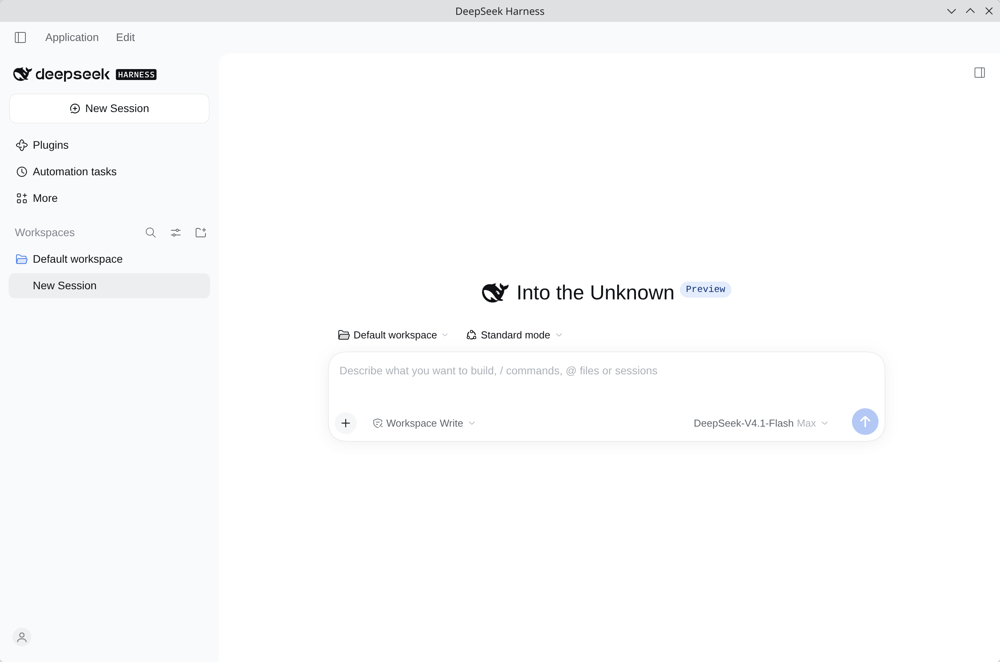
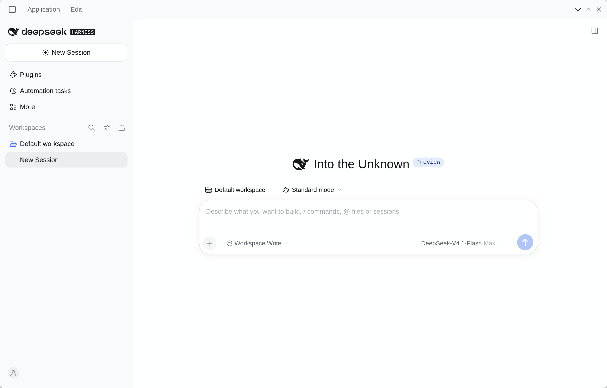
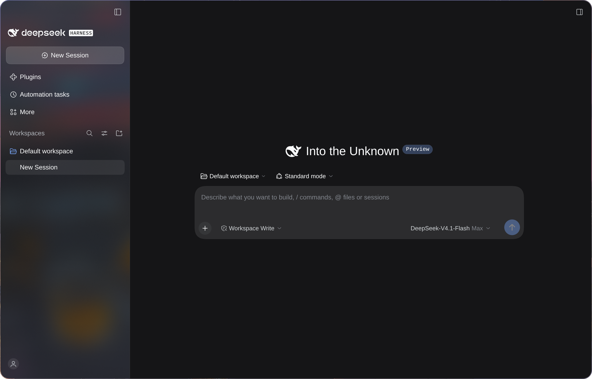

# dsh-desktop-linux

**中文** | [English](README.en.md)

把 [DeepSeek Harness](https://github.com/deepseek-ai/deepseek-harness) 官方桌面端
（`apps/desktop` 的 Electron 应用）的**打包流水线**移植到 Linux，产出
AppImage / deb / rpm / Arch 包。

上游目前不支持 Linux；本项目将其补齐：让官方打包流水线认得 `linux-x64` 与
`linux-arm64` 并产出安装包。


*普通模式（KDE Plasma）*


*无边框模式（KDE Plasma，`DSH_DESKTOP_FRAMELESS=1`）*


*玻璃模式（Hyprland，`DSH_DESKTOP_GLASS=1 DSH_DESKTOP_GLASS_TINT=75`）*

## 项目产物

本项目的产物是**官方 Electron 应用本身**：

- 渲染走自己的 `dsh-app://` 协议，而不是去连一个本地 Web 服务；
- 内置 Node / pnpm / Python 运行时，不依赖系统 Node；
- 独占 `$DSH_HOME/profiles/desktop`，不占用 `web` profile。

## 安装

可从 [Releases](https://github.com/ffyfox/dsh-desktop-linux/releases) 下载 AppImage / deb / rpm / Arch 包。

| 发行版 | 格式 | 安装方式 |
|---|---|---|
| 通用 | AppImage | `chmod +x` 后直接运行 |
| Debian / Ubuntu | deb | `sudo apt install ./deepseek-harness-*.deb` |
| Fedora / RHEL | rpm | `sudo dnf install ./deepseek-harness-*.rpm` |
| Arch Linux | `.pkg.tar.zst` | `sudo pacman -U ./dsh-desktop-linux-*.pkg.tar.zst`；也可本地构建，见[构建 Arch 包](#构建-arch-包)；由于 AUR 暂停账号注册等原因，本项目不发布到 AUR。 |

## 使用

### 关窗、托盘与退出

关闭主窗口默认只会**隐藏到后台**（Host 与正在执行的任务继续运行），不会退出程序：

- **找回窗口**：托盘菜单「打开」，或再次启动应用（第二次启动只会聚焦已有实例）。
- **完全退出**：托盘菜单「退出」、菜单栏「应用」→「退出」、或 `Ctrl+Q`。

### 无边框模式

想让窗口去掉系统装饰、只保留窗口控制按钮，加环境变量启动：

```bash
DSH_DESKTOP_FRAMELESS=1 deepseek-harness
```

开启后窗口样式近似官方 Windows 桌面端：

- 去掉系统标题栏，改由页面内顶部区域负责拖拽移动与双击最大化 / 还原；窗口控制按钮的样式、数量与位置跟随系统 GTK 主题及装饰布局。
- **与玻璃模式互斥**：两个变量同时设为 `1` 时，无边框优先，玻璃模式自动关闭。
- **左置按钮限制**：系统把窗口按钮放在左侧时，页面内菜单会自动右移避让，但侧栏顶部的切换钮暂未完整适配。

### 玻璃模式

想让侧栏呈现毛玻璃效果（或无模糊半透明效果），加环境变量启动：

```bash
DSH_DESKTOP_GLASS=1 deepseek-harness
```

开启后窗口样式近似官方 macOS 桌面端：

- 原生菜单栏自动隐藏，按 `Alt` 唤出。
- 侧栏浓度默认浅色 40%、深色 50%，可通过 `DSH_DESKTOP_GLASS_TINT=0..100` 调整，文字受背景干扰时可调高。
- **实际观感取决于合成器**：Hyprland、niri 等支持背景模糊；KDE 与 GNOME 仍带系统标题栏且仅呈半透明、无模糊——此模式在**无系统标题栏**的平铺窗口管理器下可能观感更佳。

## 从源码构建

依赖：Node 24.9+（**别用发行版自己打的 Node**，见下）、**pnpm 11**、git。
打 rpm 还需要系统有 `rpmbuild`。

```bash
git clone https://github.com/ffyfox/dsh-desktop-linux
cd dsh-desktop-linux

./scripts/fetch-upstream.sh                   # 拉上游源码（默认用 PKGBUILD 里钉的 tag）
./scripts/apply-patches.sh                    # 打补丁并放置资源
pnpm --dir upstream install --frozen-lockfile # 安装上游工作区依赖
./scripts/build.sh --all                      # AppImage + deb + rpm
./scripts/verify.sh --runtime                 # 验证矩阵
```

`build.sh` 参数：`--dir`（仅生成未打包目录，调试最快）、`--appimage`（默认）、`--deb`、`--rpm`、`--all`。耗时大头在前面的编译与运行时准备，需要多种格式时建议用 `--all` 一次跑完。

产物落在 `upstream/apps/desktop/.desktop-build/targets/linux-x64/unsigned-artifacts/`（arm64 机器上是 `targets/linux-arm64/…`；`build.sh` 按 `uname -m` 自动选目标，不支持交叉构建）。

deb / rpm 的 `Maintainer` 与 `Homepage` 取自 `upstream/apps/desktop/.env.linux`（首次运行 `build.sh` 时自动从 `.env.linux.example` 生成；只认该文件，不读同名环境变量）。

### 硬性前提

- **Node 24.9+（需支持 TypeScript 类型剥离）**：部分发行版自己打的 Node 裁掉了该特性，会在构建第一步报错；请使用 nodejs.org 官方包。
- **pnpm 11（需通过 npm 或 corepack 安装）**：上游声明 `packageManager: pnpm@11.28.5`，且构建脚本会直接用 `node` 执行 `pnpm` 入口。官方 standalone 安装器、Homebrew，以及部分滚动发行版的系统包（如 Arch Linux 的 pnpm 12 自管理切换后）给的是二进制入口（`@pnpm/exe`），会报 `SyntaxError`；`build.sh` 与 `PKGBUILD` 检测到系统 `pnpm` 不合用时会自动回退到隔离版 `~/.local/share/dsh-pnpm-11`，可提前装好：

  ```bash
  npm i --prefix ~/.local/share/dsh-pnpm-11 pnpm@11.28.5
  ```

### 构建 Arch 包

`PKGBUILD` 直接使用上游 release 源码包构建，不依赖 `./upstream` 检出：

```bash
./scripts/pkgbuild-dir.sh     # 摊平补丁与资源到 ./pkgbuild
cd pkgbuild && makepkg -si
```

支持 `x86_64` 与 `aarch64`（需在对应架构下原生构建）。

## 实现机制

```
官方 Electron 壳（apps/desktop）
├── 渲染进程 ──── dsh-app:// 协议 ──── 应用 UI
└── Host 进程 ─── primary-runtime 自带的真 Node ─── 捆绑的 dsh 运行时
                       └── $DSH_HOME/profiles/desktop
```

三个设计点：

- **Host 跑在真 Node 上，不是 Electron 的 node 模式。** Electron 的 node 模式下 `sharp` 解码会段错误，
  所以 Linux 的 Host 改走 primary-runtime 自带的 Node。连带地，**Linux 产物的 dsh 目录树不放进 asar**
  （真 Node 读不了归档），这是安装目录体积偏大的原因。
- **profile 独占。** 桌面端独占 `$DSH_HOME/profiles/desktop`，会话、设置与凭据仍在 `$DSH_HOME` 根下与 CLI 共享。若想复用 `web` 的配置，退出桌面端后把 `$DSH_HOME/profiles/web` 复制或改名过去即可；也可通过符号链接共用该目录，但两边会互相改写，版本跨度较大时可能出现未知问题。
- **沙箱。** 内核支持非特权 user namespace 时走 namespace 沙箱；不支持才退回 setuid `chrome-sandbox`。AppImage 在启动时探测，deb / rpm / Arch 包在安装脚本里判断。

补丁系列的编号、职责划分与底层细节见 [patches/README.md](patches/README.md)。

## 验证状态

下表随测试和反馈更新——如果发现适配问题，欢迎在
[Issues](https://github.com/ffyfox/dsh-desktop-linux/issues) 提出。

| 环境 | 状态 |
|---|---|
| Arch Linux · KDE Plasma 6 · Wayland · x86_64 | **已实测**，正常 |
| Arch Linux · Hyprland 0.57 · Wayland · x86_64 | **已实测**，正常 |
| Arch Linux · niri 26.04 · Wayland · x86_64 | **已实测**，正常 |
| Ubuntu 26.04 LTS · GNOME 50 · Wayland · x86_64 | **已实测**，正常 |
| Debian 13 · GNOME 48 · Wayland · x86_64 | **已实测**，正常（托盘要装扩展，见[已知限制](#已知限制)） |
| Fedora 44 Workstation · GNOME 50 · Wayland · x86_64 | **已实测**，正常（托盘要装扩展，见[已知限制](#已知限制)） |
| aarch64（AppImage / deb / rpm / Arch 包） | 已在 CI 通过构建与启动冒烟 |
| 其他发行版（Linux Mint / CachyOS 等） | 未验证 |
| 其他 DE/WM（Xfce / Sway 等） | 未验证 |
| X11 | 未验证 |

## 已知限制

- **GNOME 默认看不到托盘，需安装并启用扩展。** 需安装 `gnome-shell-extension-appindicator`（Ubuntu 默认已装；Debian / Fedora 需手动安装），**注销重登**后启用 `ubuntu-appindicators@ubuntu.com`。未启用托盘时，关窗后只能靠二次启动把窗口找回。
- **AppImage 要系统提供 FUSE 2（`libfuse.so.2`）。** 主流发行版现在默认只装 FUSE 3，直接运行会报 `dlopen(): error loading libfuse.so.2`。装对应包即可：Fedora `sudo dnf install fuse-libs`、Debian 13 与 Ubuntu 24.04+ `sudo apt install libfuse2t64`（Ubuntu 22.04 为 `libfuse2`）；或用 `APPIMAGE_EXTRACT_AND_RUN=1 ./deepseek-harness-*.AppImage` 绕过。
- **没有自动更新。** 上游更新通道仅面向 Windows 与 macOS，Linux 版不嵌入更新策略、不会自动更新。
- **没有「安装命令行工具」入口。** 上游仅在 macOS / Windows 实现了从菜单把 `dsh` CLI 装进 PATH 的分支；在终端使用 `dsh` 需自行安装，或直接调用应用自带的 `resources/app/dsh/node_modules/@deepseek-ai/dsh/lib/bin.js`（配 `resources/runtime/primary-runtime` 里的 node）。
- **不签名。** 产物是 unsigned 构建。
- **Platform 侧会把 Linux 客户端认成 macOS。** 上游客户端身份映射为 `platform === 'win32' ? 'desktop-win' : 'desktop-mac'`，Linux 落到 `desktop-mac`（同一请求里的 `device_model` 仍为 `linux-x64` 或 `linux-arm64`）。

## 许可

MIT

DeepSeek Harness 本身由 DeepSeek 开发。本项目是独立的社区项目，不是 DeepSeek 官方产品，与 DeepSeek 无隶属关系。
