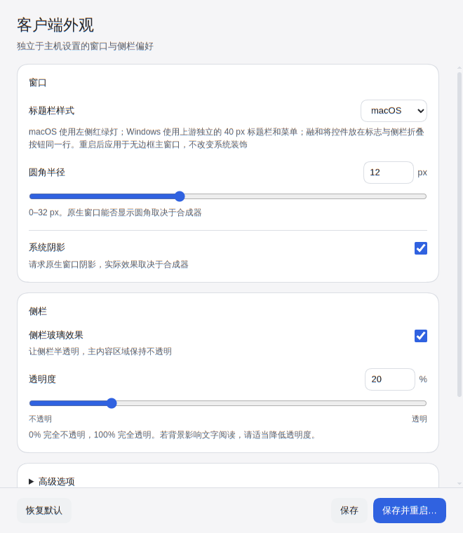
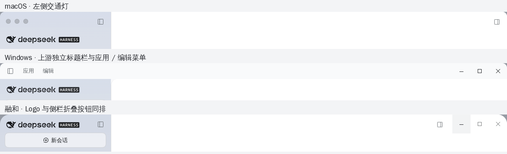
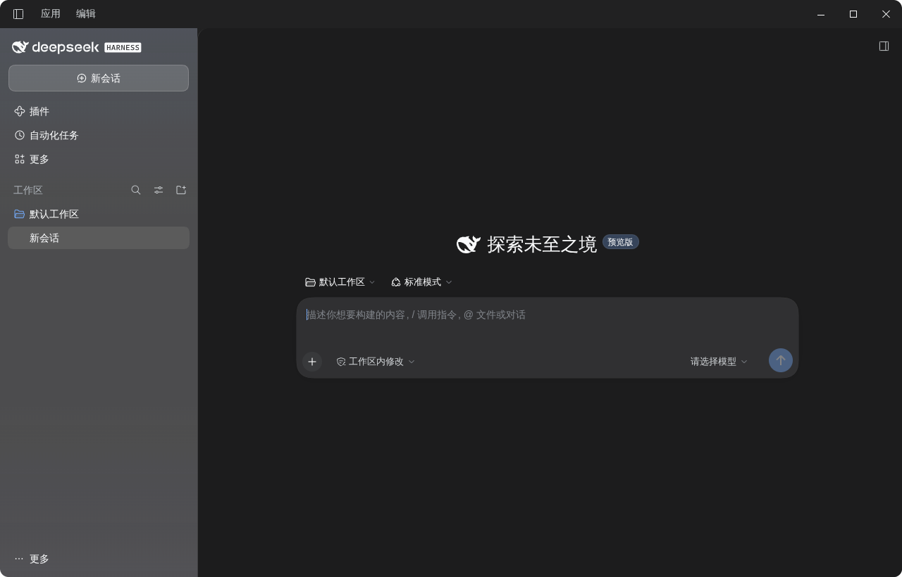
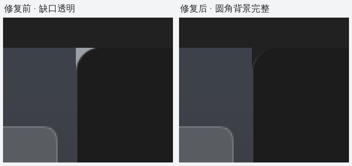
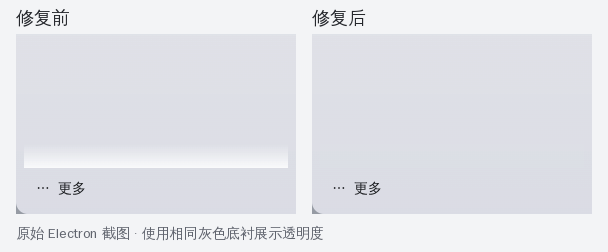

# 客户端外观

**中文** | [English](client-appearance.en.md)

补丁 `0020` 提供独立的窗口与侧栏设置。需使用包含此补丁的构建，旧 release 下载不代表支持本页功能。构建入口见[README](../README.md#从源码构建)。



## 调整与保存

从托盘选择「客户端设置…」，选择 macOS（左侧交通灯）、Windows（上游独立 40 px 标题栏、折叠按钮及「应用 / 编辑」菜单）或融和（右侧窗口按钮，Logo 与折叠按钮同排）标题栏样式，调整圆角、系统阴影、侧栏玻璃及透明度；「高级选项」包含主窗口无边框和 Wayland 背景模糊。设置窗口始终保留系统边框和不透明背景，并请求默认系统阴影，不受主窗口外观设置影响，关闭它只关闭该窗口。

默认配置不需要旧环境变量：macOS 标题栏、无边框开启、圆角 12 px、系统阴影开启、侧栏玻璃开启、透明度 20%（填充不透明度 80%）、Wayland 模糊开启。无边框与玻璃可以同时使用，不再互斥。



Windows 样式复用上游标题栏、菜单和内容区布局，而非仅将窗口按钮挪到右边。内容区内侧圆角下方以标题栏颜色衬底，不会透出桌面或出现亮色缺口；侧栏玻璃与窗口外圆角不受影响。深色实测效果：



内侧圆角修复前后的真实截图使用相同底衬展示透明缺口：



「恢复默认」只填入默认值，需再次保存才写入文件。「保存」只影响下次启动，当前窗口和主机任务保持运行；页面区分当前运行与下次启动的值。保存失败时，表单保留供修正或重试，不显示为已保存。

「保存并重启…」先保存，再显示原生确认框。确认框默认选择取消，明确警告运行中的主机任务会中断、重启期间计划任务不能运行；只有再次确认才请求重启。取消重启不会撤销刚保存的配置，它仍会在下次启动时生效。

## 配置文件与兼容初始值

配置单独存于 `app.getPath('userData')/desktop/appearance.json`，不在 `$DSH_HOME`，也不修改主机配置。读取设置不创建文件；保存使用 mode 0600 的原子替换，写入失败保留原文件。未知字段、无效 JSON、字段类型或范围错误、未知版本均明确报错，不静默回退或覆盖原文件。

完整的版本 3 文件示例：

```json
{
  "schemaVersion": 3,
  "frameless": true,
  "titlebarStyle": "macos",
  "cornerRadius": 12,
  "systemShadow": true,
  "sidebarGlass": true,
  "sidebarOpacity": 80,
  "waylandBlur": true
}
```

`titlebarStyle` 只接受 `macos`、`windows` 或 `fusion`（融和），仅在主窗口无边框时生效，系统边框和独立设置窗口仍由合成器绘制。`frameless`、`systemShadow`、`sidebarGlass`、`waylandBlur` 必须为布尔值；`cornerRadius` 为 0–32 的整数，`sidebarOpacity` 为 0–100 的整数，不接受字符串或小数。UI 透明度为 `100 - sidebarOpacity`：0% 完全不透明，100% 完全透明。

仅当配置文件不存在时，`DSH_DESKTOP_FRAMELESS` 与 `DSH_DESKTOP_GLASS` 提供兼容初始值：未设置沿用默认，显式值只有 `1` 表示开启。`DSH_DESKTOP_GLASS_TINT` 的有效整数 0–100 作为初始填充不透明度，非法值沿用默认。**保存文件存在后，其值优先于这些环境变量**；加载的当前运行快照不会被后续保存或环境变化修改。

版本 1 的六字段文件读取时补充 macOS；版本 2 的 `windows` 明确迁移为 `fusion`，保留此前无菜单的融和外观，`macos` 保持不变。所有旧偏好（包括透明度）保留，读取不自动写回，下次保存才写版本 3。回滚到版本 2 时先备份，将 `fusion` 改回 `windows`，再将 `schemaVersion` 改回 `2`；新 Windows 独立标题栏在旧版不可用。回滚到仅支持版本 1 的客户端时，还须移除 `titlebarStyle`，其余六个值不变。

文件无效时，请先备份，再修复字段或使用兼容该版本的应用打开。不要直接改动文件期待热生效；外部手动修改也需要重新启动。该文件不接受 API Key、Token 或其他凭据字段。

## 合成器支持与安全

KDE Plasma 6.8.2 / Wayland 已验证背景模糊、shadow v2 及透明圆角，设置保存和重启闭环也已实测。Wayland relay 通过合成器协议请求模糊与阴影，根视图裁剪为圆角提供真实 alpha；它使用 resources 内捆绑的 primary-runtime Python，不依赖系统 Python。

玻璃侧栏不再绘制会话列表底部的不透明渐隐遮罩，避免页脚上方出现白带；普通不透明侧栏和内容区不受影响。下图是同一窗口的真实截图，以相同灰色底衬展示 alpha 差异。



开关表示请求效果，不保证任意桌面环境都实现该效果。系统边框开启时，原生圆角由合成器控制；不支持相关协议的合成器可能只有透明度而没有模糊或阴影。其他合成器和 X11 的新效果仍需实测，不能从既有安装包启动成功推断外观能力。

设置窗口启用 Electron sandbox 与 context isolation、禁用 Node integration，仅向页面暴露 `get/save/restart` 三个动作，并核对唯一窗口、主 frame 和精确本地文件 URL。页面使用严格 CSP 和外部脚本/样式，拒绝任意导航、弹窗及权限，不读取或传递 API 凭据。增强效果不要求关闭 Chromium 沙箱或改写用户全局合成器设置。

## 维护者验证

应用完整补丁并安装依赖后，运行 `./scripts/check-appearance.sh` 执行桌面、Host 和 Python relay 回归；`python3 scripts/check-patches.py` 从 `PKGBUILD` 固定提交分别验证 Git / GNU patch 两条路线与本地校验和，不修改现有源码树。`--source` 可显式指定已有上游 Git 检出。

原生桌面验证需要未打包的 Linux 产物和可用 Wayland socket：`python3 scripts/smoke-client-settings.py --source /path/to/unpacked --display wayland-1` 验证设置、控件与重启；追加 `--scenario windows-corner` 核对内容圆角和侧栏 alpha。每次使用临时 runtime / 空 profile，不读取真实用户设置。单测与像素测试不代替其他合成器、发行版或 arm64 的实测。

补丁依赖与实现范围见[0020 说明](../patches/README.md#独立客户端外观与-kde-wayland-效果0020)。
